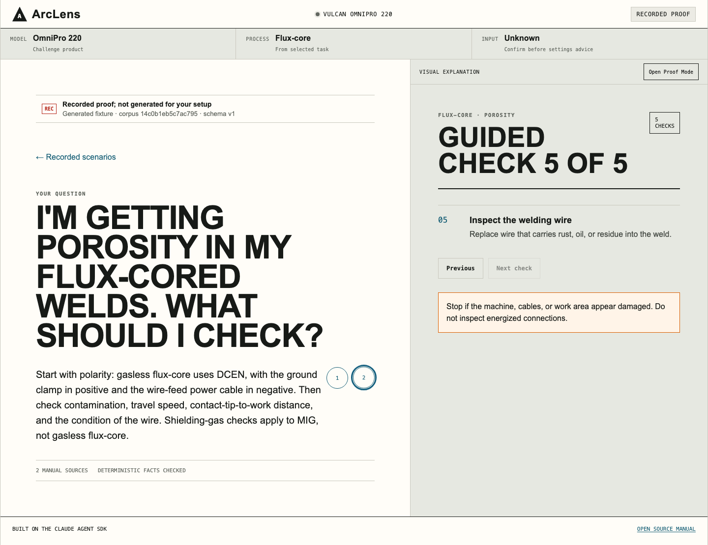

# ArcLens

ArcLens is a source-grounded visual product expert for the Vulcan OmniPro 220. It answers setup and troubleshooting questions from the supplied manuals, computes safety-critical facts in deterministic code, and returns inspectable citations and visual artifacts.

The default experience needs no API key and makes no provider calls. It opens a complete Recorded Proof of the three challenge flows so an evaluator can inspect the product immediately.

**Hosted evaluation:** [Open ArcLens on Vercel](https://arclens-omnipro.vercel.app)



## Run it in two commands

Requirements: Node.js 24 and npm 11. The repository pins Node `24.10.0` in `.nvmrc`.

```bash
npm ci
npm run dev
```

Open [http://localhost:3000](http://localhost:3000). The header should show **Recorded proof**, and the question field should be disabled with the prompt to add a key for live answers. Try the three suggested questions:

- "What's the duty cycle for MIG welding at 200A on 240V?"
- "I'm getting porosity in my flux-cored welds. What should I check?"
- "What polarity setup do I need for TIG welding? Which socket does the ground clamp go in?"

Each recorded fixture includes a domain-built visual, cited manual pages, and an expandable Proof Mode. The fixtures are clearly labeled "not generated for your setup" and derive their facts from the same deterministic domain functions used to validate live artifacts; they are not presented as live SDK output. This `build-no-key` mode is intentionally useful even when no Anthropic credential is available.

If port 3000 is busy, use `PORT=3001 npm run dev` and open [http://localhost:3001](http://localhost:3001).

## Enable live Claude answers

Live mode uses the Claude Agent SDK and can incur Anthropic API charges. Copy the example configuration, add one key, and restart the development server:

```bash
cp .env.example .env.local
```

```dotenv
ARCLENS_MODE=live-local
ANTHROPIC_API_KEY=sk-ant-...
```

Then run `npm run doctor -- --mode live-local` followed by `npm run dev`. The header should show **Live · local**. Every live request is limited to eight turns and a maximum configured spend of USD 0.75; lower the cap with `ARCLENS_MAX_BUDGET_USD` if desired.

See [Getting started](docs/getting-started.md) for expected output and a complete smoke test, or [Configuration](docs/configuration.md) for all modes and variables.

## What makes the answer trustworthy

ArcLens does not ask a model to improvise an answer and decorate it afterward. It narrows the agent to five in-process MCP tools, validates every source and artifact, recomputes critical facts in code, and commits the answer and visuals as one transaction.

```text
question
   |
   v
Next.js /api/chat  -- validates request, mode, budget
   |
   v
Claude Agent SDK   -- no built-in tools, five ArcLens MCP tools only
   |
   +--> verified manual search + page retrieval
   +--> deterministic process-specific duty-cycle / polarity / porosity facts
   +--> server-built visual artifacts
   |
   v
grounding validator + request transaction
   |
   v
one committed answer bundle: answer + artifacts + source IDs + checksum
```

The integration is the actual `@anthropic-ai/claude-agent-sdk`, not a hand-rolled chat completion:

- `src/agent/runner.ts` calls the SDK `query()` async iterator.
- `src/agent/tools.ts` creates a real in-process MCP server with `createSdkMcpServer()` and `tool()`.
- `src/agent/options.ts` disables built-in tools and allowlists exactly five ArcLens MCP tools.
- `src/domain/grounding.ts` rejects unknown sources, unverified technical claims, context-free quote fragments, and unattached computation receipts.
- `src/domain/request-transaction.ts` prevents partial answers from reaching the UI.

Read the [architecture contract](docs/architecture.md) for the implemented trust boundary and the explicitly marked future production boundary.

## Assessment coverage

| Requirement | Implemented evidence |
| --- | --- |
| Deep technical accuracy | Process-specific facts, unsupported-setting rejection, source-bound computation receipts, and offline regression cases |
| Visual responses | Interactive duty-cycle timeline, polarity diagram, troubleshooting flow, exact manual crops, and full-PDF context |
| Manual understanding | Checksummed page text/images plus a curated visual index for charts, diagrams, diagnosis examples, and the wiring schematic |
| Claude Agent SDK | Real `query()` execution with five in-process MCP tools and no SDK built-ins |
| Fast local evaluation | Two-command no-key start, three labeled Recorded Proof fixtures, and an optional one-key live-local mode |

The assessment build deliberately does not claim image upload, voice, hosted multi-user chat, or expert authoring. Those require the production controls listed in [Architecture](docs/architecture.md#future-production-design-not-implemented-in-v01).

## Commands

| Command | Purpose | Network / API spend |
| --- | --- | --- |
| `npm run dev` | Start the app in the configured mode | No provider call until a live question is submitted |
| `npm run doctor` | Load local config; check Node, mode spelling, key shape, lockfile, knowledge, SDK import, and port | None |
| `npm run check:knowledge` | Verify committed manual assets and checksums | None |
| `npm run build:knowledge` | Rebuild generated pages, crops, and indexes from the supplied PDFs | None; requires local PDF tools |
| `npm run test` | Run the offline Vitest suite | None |
| `npm run eval:offline` | Run the sixteen-case deterministic, cross-page, and retrieval holdout set | None |
| `npm run typecheck` | Run TypeScript without emitting files | None |
| `npm run lint` | Run ESLint | None |
| `npm run build` | Create a production Next.js build | None after install |
| `npm run verify` | Run knowledge checks, types, lint, tests, and build | None after install |
| `npm run help` | Print the operator command summary | None |

The complete command and exit-code reference is in [Commands](docs/commands.md).

## Verification

Before review or release:

```bash
npm run verify
npm run eval:offline
node scripts/check-docs.mjs
```

The offline eval report is written to `evals/results/offline.json`. Live provider calls are deliberately not part of `npm run verify`; no test command should spend credits without an explicit operator action.

## Repository map

```text
src/app/                 Next.js UI and API routes
src/agent/               Claude Agent SDK options, runner, and MCP tools
src/domain/              schemas, deterministic facts, grounding, transactions
src/knowledge/           verified search index, manifest, and generated metadata
src/security/            local asset allowlists, headers, and redaction
public/manuals/          supplied source PDFs
public/manual-pages/     generated page images
public/manual-regions/   generated crops that enrich visual retrieval
tests/                   offline unit, contract, security, API, and UI tests
evals/                   versioned offline evaluation cases and reports
scripts/                 doctor, knowledge build/check, docs check, eval runner
docs/                    product, architecture, security, testing, and operations
```

## Documentation

- Start here: [Getting started](docs/getting-started.md)
- Operate it: [Commands](docs/commands.md), [Configuration](docs/configuration.md), [Error reference](docs/errors.md)
- Understand it: [Architecture](docs/architecture.md), [Security posture](docs/security.md), [UI design contract (implemented and planned flows)](docs/designs/arclens-ui-spec.md)
- Validate it: [Test plan](docs/test-plan.md), [Release checklist](docs/release-checklist.md), [Demo script](docs/demo-script.md)
- Maintain it: [Knowledge build guide](docs/how-to-maintain-knowledge.md), [Contributing](CONTRIBUTING.md), [Security policy](SECURITY.md), [Changelog](CHANGELOG.md)
- Review the design process: [Assessment](docs/designs/arclens-assessment.md) and [developer-experience contract](docs/developer-experience.md)

## Troubleshooting

- **Wrong Node version:** run `nvm use`, `fnm use 24`, or install Node 24, then rerun `npm ci`.
- **Port already in use:** run `PORT=3001 npm run doctor`, then `PORT=3001 npm run dev`.
- **Live answers unavailable:** ensure `.env.local` contains both `ARCLENS_MODE=live-local` and a valid `ANTHROPIC_API_KEY`, then restart.
- **Knowledge validation failed:** run `npm run build:knowledge`, inspect the generated diff, then rerun `npm run check:knowledge`.
- **A live answer was rejected:** this is a fail-closed result, not a partial success. Use the error code and request ID with the [error reference](docs/errors.md).

For contribution workflow and review expectations, see [CONTRIBUTING.md](CONTRIBUTING.md). To report a vulnerability privately, follow [SECURITY.md](SECURITY.md).
